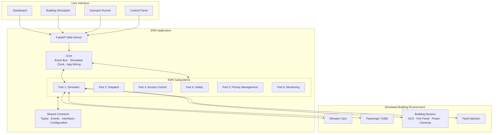

# Elevator Management System (EMS), Release 1

Team 1's implementation of Team 3's SRS v0.13: supervisory software for a
30-floor office tower (8 passenger cars + 1 service car), running on simulated
controllers, access control, cameras and building signals.

**Read first:** [docs/CONTRACT.md](docs/CONTRACT.md) (rules every part follows).

## Setup
```bash
python -m venv .venv && source .venv/bin/activate   # Windows: .venv\Scripts\activate
pip install -e ".[dev]"
pytest                                            # must pass before every PR
uvicorn ems.web.server:app --reload               # http://localhost:8000
```

## Layout
```
ems/
  contracts/   shared types, events, interfaces, config, stubs   (tech lead only)
  core/        clock, event bus, app wiring                       (tech lead only)
  sim/         Part 1 Simulator & integration
  dispatch/    Part 2 Dispatch & modes
  access/      Part 3 Access & panels
  safety/      Part 4 Safety & edge cases
  priority/    Part 5 Priority & service car
  monitor/     Part 6 Dashboard, camera & admin
  web/         FastAPI server + static pages (dashboard, panel, building, runner)
tests/
  <part>/      your unit tests
  scenarios/   SIM-xx / VER-xx acceptance tests (Appendix B)
docs/          contract, scope note for Team 3
scripts/       create_issues.sh + requirements.csv
```


## System Architecture

The Elevator Management System (EMS) is implemented as a single Python application with an event-driven architecture. Its components communicate through shared contracts and an in-process event bus, while a simulated clock coordinates time-dependent operations.



### Component Overview

| Component | Responsibility |
|---|---|
| **Core** | Provides the event bus, simulated clock, application context, and component wiring. |
| **Part 1 - Simulator** | Simulates elevator movement, passenger traffic, building devices, and injected faults. |
| **Part 2 - Dispatch** | Responsible for elevator assignment, scheduling, and dispatch modes. |
| **Part 3 - Access Control** | Handles access permissions, passenger authentication, and control panels. |
| **Part 4 - Safety** | Handles fire alarms, emergency procedures, and safety-related events. |
| **Part 5 - Priority Management** | Manages VIP, accessibility, and service-car priorities. |
| **Part 6 - Monitoring** | Provides system monitoring, dashboards, camera events, and administrative functions. |
| **Web Interface** | Exposes the EMS through the dashboard, building simulation, control panel, and scenario runner. |


## Workflow
1. Pick an issue assigned to you (one issue = one requirement ID).
2. Branch from `main`: `part<N>/<short-name>`, e.g. `part5/vip-caps`.
3. Commit small and often; push your branch daily.
4. Open a PR titled with the requirement ID (`FR-72 VIP caps`), link the issue.
5. CI must be green and 1 reviewer must approve; then squash-merge.
6. Need a contract change? Open a "Contract change request" issue; don't edit `contracts/`.

## Milestones (Part 1)
- **v0.1-sim-core**: car simulator, traffic generator (5 profiles, population of about 2,500 people), scenario harness with evidence manifests.
- **v0.2-sim-devices**: mock ACS / notifier / fire panel / power room / camera, fault injection, heartbeat (FR-104), database buffering (FR-107), server failover (NFR-R2).
- **v0.3-demo**: building animation page, scenario runner page, FR-105 dispatch guard, scenario registry (SIM-01..SIM-18), peak rate default 35/min (decision D-01).
- **v0.4-scenario-setup**: every Appendix B setup is executable: runs start at a time of day, 24 h weekday run with per-block metrics (SIM-05), Eco surge (SIM-04), design-limit building and latency hooks (SIM-10).

### Run the demo
```bash
pip install -e ".[dev]"
uvicorn ems.web.server:app          # offline, no build step
```
Open http://localhost:8000/building/ (pick a profile, press Start, then Play; speed 1x / 10x / 60x; fault buttons on the right) and http://localhost:8000/runner/ (run SIM-09 and SIM-16 over seeds 1-10; the other scenarios say which part still has to add its check in `ems/sim/scenarios.py`).

