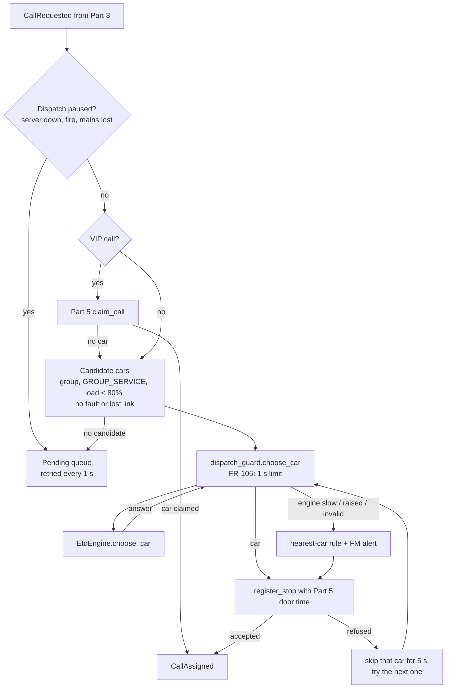

# Part 2 Dispatch & modes

Package `ems/dispatch`, service `ctx.services["dispatcher"]` (the `Dispatcher` protocol in
`contracts/interfaces.py`). The dispatch plug-in (FR-06) is `EtdEngine`, always called through
Part 1's FR-105 guard (`ctx.services["dispatch_guard"].choose_car`).

## What it does
| Requirement | Behaviour | Module |
|---|---|---|
| FR-01/02, UC-01 | `CallRequested` -> candidate cars -> engine (via guard) -> `register_stop` -> `CallAssigned`; one car per hall call | `service.py`, `assign.py` |
| FR-04 | fault, lost link, non-dispatchable car state, Part 5 removal: waiting calls move with `CallReassigned`, original `created_at` kept; calls that cannot move yet are retried every second | `assign.py` |
| FR-05 | no new hall call for a car at or above 80% load | `assign.py` |
| FR-06 | `EtdEngine` behind `DispatchEngine` (replaceable) | `engine.py` |
| FR-08, BR-10 | `claim_call` for VIP; `car_ok_for` for accessible calls; `door_dwell_s` as `min_dwell_s`; pending queue ordered by Part 5 `order()` | `assign.py` |
| FR-10/11/12 | Rush / Balanced / Eco; weekday, weekend and holiday schedule; FM manual switch until a time or the next scheduled change (`set_manual_mode`) | `modes.py` |
| FR-13, BR-01 | ceiling penalties in the cost; `WaitCeilingRisk` at 90% of the ceiling; Eco wakes a Standby car; breaches logged with cause, FM alerted (at most one alert per group per 5 min) | `engine.py`, `ceiling.py` |
| FR-14, BR-05 | Eco -> Balanced when > 10 calls wait for 30 s or the 5-min average wait > 45 s; FM alert; stays until the next scheduled change | `ceiling.py`, `modes.py` |
| FR-15, BR-02 | a mode change never cancels a call or a trip | `modes.py` |
| FR-100 | overload: step-out message naming the next car (car display + panels) at once, then the calls left at that floor are re-assigned | `assign.py` |
| FR-101 | the trip model never puts more persons on one trip than rated (or the FM limit, `set_persons_limit`) | `model.py`, `engine.py` |
| 4.3 table | parking: Rush -> lobby (up-peak) / spread over the zone (down-peak) / mixed; Balanced -> lobby + busiest recent floors; Eco -> stay where the last trip ended, 2 cars per group in service, the rest in Standby | `policy.py` |
| Pauses | EMS server down (controllers serve calls), fire (until cleared and `safety_active()` is False, FR-55), mains lost (FR-110): no command sent, calls queue; after fire every waiting call is re-assigned | `pauses.py` |

## How a call is assigned



The guard measures the engine with real time (`time.perf_counter`); automatic garbage collection
is paused during the call so a process-wide GC pass is not counted as engine time (#101).

## The algorithm (ETD, estimated time to destination)
The dispatcher knows every passenger's destination (destination panels); the controller only learns
it when the passenger boards. So the dispatcher keeps a book of who rides and who waits for each car,
and `model.replay()` replays the controller's stop logic (simple collective, Appendix B timings:
1.5 s per floor, 2 s open, at least 5 s dwell or 1 s per person, 2 s close, 21 persons) to predict
every pick-up and arrival time. Prediction error measured at up-peak: about 1.5 s on average.

For a new call each candidate car is replayed twice, without and with the call. The difference is
the cost of giving the call to that car; the cheapest car wins (ties: lower car id).

```
w_wait * f(new wait) + w_ride * new ride
+ sum over the car's other passengers of extra wait (f) and extra arrival delay (w_ride)
+ w_run  * extra moving seconds + door cycles      (energy)
+ w_busy * extra seconds the car stays busy        (later passengers wait for it)
+ 10 per second a passenger is pushed past 75% of the mode ceiling
+ hard penalty per second a passenger is pushed past the ceiling itself (Balanced: 100)
f(w) = w + w^2 / ceiling                            (long waits weigh more)
```

| Term | Why |
|---|---|
| `f(w)` quadratic in the wait | Two waits of 20 s are better than 0 s and 40 s: long waits cost more than their length (BR-01). |
| other passengers' extra delay | The nearest car may already carry people to many floors; one more stop delays all of them. Nearest-car ignores this. |
| `w_busy` | Every second a car stays busy is a second later back at the lobby for passengers who have not arrived yet. This makes each trip serve few floors (up-peak sectoring). |
| `w_run` | Moving seconds and door cycles are energy. Only Eco weighs them strongly. |
| soft and hard ceiling penalties | Keep anyone close to the mode's wait ceiling from being pushed further back. |
| FR-101 | A car where the call would not fit on the trip, or would push someone else off, is not a candidate. |

| Mode | w_wait | w_ride | w_run | w_busy | Hard penalty | Why |
|---|---|---|---|---|---|---|
| Rush | 1.0 | 0.25 | 0 | 1.0 | 0 | Waits first. A hard penalty lengthened peak trips and raised the average (measured on SIM-01/02). |
| Balanced | 1.0 | 0.5 | 0.2 | 0.5 | 100 | Waits and ride time, some energy; the hard penalty brought SIM-03 from 4 to 3 seeds over 90 s. |
| Eco | 1.0 | 0.3 | 3.0 | 0 | 0 | One second of running costs three seconds of waiting: fewer and shorter runs (SIM-04: 20-27% less run time than Balanced). |

**Lobby door hold (Rush up-peak only).** When most recent calls start at the lobby, a lobby pick-up
asks the controller for a longer door time (6-10 s) if the next car of the group is far away, so a car
is there to board. The wait clock stops at boarding, so this lowers waits at the cost of ride time.
Longer holds (up to 30 s) were tried and made the 35/min peak worse.

**Wear.** After costing, cars within a small cost allowance of the best one are compared by distance
travelled and the least-worn one wins, so waits keep priority. The CR-01 rework (stronger allowance,
Eco standby rotation, real 24 h / 7 day / month runs) is in #104 by Mai. Real 24 h weekday runs
from zero, seed 1:

| Policy | LOW imbalance | HIGH imbalance | Average wait | Source |
|---|---|---|---|---|
| Wear term disabled | 30.6% | 39.7% | 22.95 s | #104 |
| Before CR-01 (near ties only, allowance 5) | 9.3% | 40.0% | | #58 |
| CR-01 policy | 0.50% | 0.89% | 22.4 s | #104 (7 days: 0.10% / 0.25%) |

The near-tie rule alone did not balance the high-rise group; #104 adds a stronger allowance and
rotates which cars stay in service during Eco.

## Modes (SRS 4.3)

| | Rush | Balanced | Eco |
|---|---|---|---|
| Wait target / ceiling | 25 / 60 s | 30 / 90 s | 45 / 120 s |
| Idle cars park | lobby (up-peak), spread over the zone (down-peak), mixed (lunch) | one at the lobby, the others at the busiest recent floors | where the last trip ended (no empty runs) |
| Cars in service | all | all | 2 per group, the rest in Standby |

- **Schedule (FR-11):** weekdays 00:00 Eco, 07:00 Rush, 09:30 Balanced, 11:30 Rush, 13:30
  Balanced, 17:00 Rush, 18:30 Balanced, 20:00 Eco; weekends and the holiday calendar are Eco.
  Every change publishes `ModeChanged` once per group.
- **Manual switch (FR-12):** the FM picks a mode for one group or all groups, until a set time or
  the next scheduled change (the next time the scheduled mode actually differs). Dashboard:
  Facility manager actions -> Manual dispatch mode; the change is audit-logged by Part 6.
- **Eco step-up (FR-14, BR-05):** when a group has more than 10 waiting calls for 30 s, or the
  5-minute average wait passes 45 s, it switches to Balanced until the next scheduled change and
  the FM gets an info alert. Under morning-peak traffic this happens within seconds, so Eco
  Standby is only visible with quiet traffic.
- **Wait ceiling (FR-13):** a call predicted at 90% of the ceiling raises `WaitCeilingRisk` once;
  in Eco a Standby car is woken. Calls that do exceed the ceiling are logged with a cause and the FM
  is alerted at most once per group per 5 minutes.
- **Mode change (FR-15, BR-02):** never cancels a call or a trip; new rules apply to new decisions
  (`docs/passenger_lists/fr15_mode_change.csv`).

## Results (simulator, real Parts 2-5 on main, 35 persons/min peaks, seeds 1-10)
| Scenario | Nearest-car stand-in | Part 2 | Target |
|---|---|---|---|
| SIM-01 up-peak | avg 47-55 s, max 305-337 s | avg 18-24 s, p95 48-64 s, max 93-249 s | 25 / 60 |
| SIM-02 lunch | avg 55-60 s | avg 23-25 s, p95 53-62 s, max 113-207 s | 25 / 60 |
| SIM-02 evening | avg 55-60 s | avg 24-26.5 s, p95 54-60 s, max 103-143 s | 25 / 60 |
| SIM-03 balanced | avg 37-38 s, max 180-213 s | avg 17-20 s, p95 45-57 s, max 76-105 s (7/10 seeds <= 90 s) | 30 / 90 |
| SIM-04 Eco pair + surge | n/a | PASS: saving 20-27%, Eco avg 14 s; step-up after about 1 min, FM alerted | 15%, 45 / 120 |
| SIM-05 weekday | n/a | schedule, no stranding, all cleared; Rush and Balanced max over the ceiling | per block |
| SIM-06, SIM-18 (Part 5) | n/a | PASS on all 10 seeds with real Parts 2/3/4 | |
| SIM-10 engine time per call | n/a | p99 about 5 ms | 99% <= 1 s |

**Known gap: the "none over" ceilings.** Averages pass. In Rush 2-7% of passengers wait more than
60 s, almost all in the high-rise group (L16-L30) at the lobby; in Balanced 0-0.33% wait more than
90 s (seeds 3, 7, 10: 102-104 s, a lobby burst while a VIP trip holds a car or all four cars are
far away). At 35/min the high-rise group runs at about 80% of its best-case capacity (D-01 table:
about 23 persons/min with full cars), so cars leave the lobby with about 12 stops per trip and the
next car is often 60-90 s away; even at 20/min a few waits pass 60 s. Tried and measured, without
fixing the maximum: other cost weights, quadratic and hard ceiling penalties, lobby door holds,
two lobby cars in Balanced, moving at-risk calls to a sooner car. The maximum depends on a few
unlucky passengers (93-249 s across seeds) while p95 is stable, so a percentile criterion is
proposed below. The failing criteria stay visible in the tests as xfails.

**Proposed D-07 (for the team to decide):**
| Mode | SRS now | Proposed |
|---|---|---|
| Rush | avg <= 25 s, none over 60 s | avg <= 25 s, >= 95% <= 65 s, >= 99% <= 95 s |
| Balanced | avg <= 30 s, none over 90 s | avg <= 30 s, >= 95% <= 60 s, >= 99% <= 90 s |
| Eco | avg <= 45 s, none over 120 s | unchanged (passes) |

**Part 5 integration notes:** a VIP `claim_call` can pick a car that already has 21 riders, so the
VIP is left behind (one 220 s wait in SIM-01 seed 3); the claimed call is Part 5's (no
`register_stop` by Part 2). The VIP-after-medical case is issue #18 (PR16-01).

## Run
```bash
pytest tests/dispatch -q                                   # unit tests
pytest tests/scenarios -q -k "sim_01 or sim_02 or sim_03 or sim_04 or sim_05"
EMS_SLOW=1 pytest tests/scenarios -q -k "sim_04 or sim_05 or sim_10"   # every seed, SIM-10
python -c 'from ems.sim.scenarios import run_scenario as r; print(r("SIM-03", 1)["criteria"])'
```
